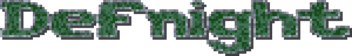
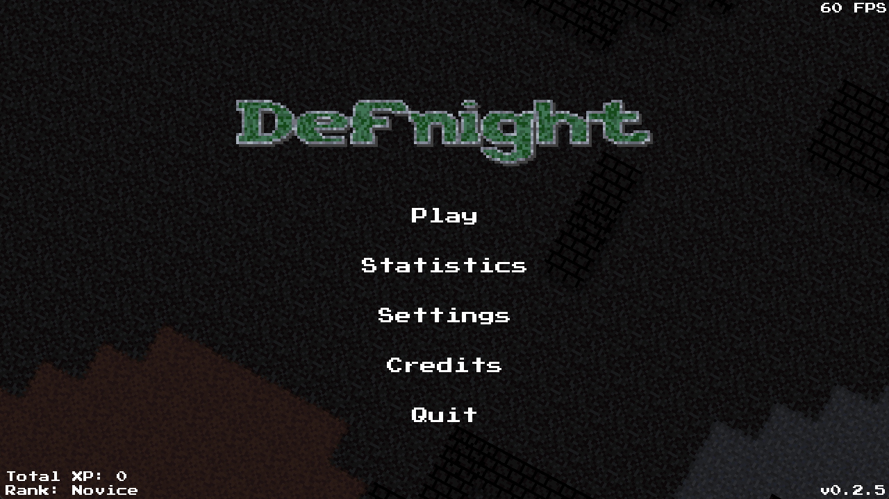
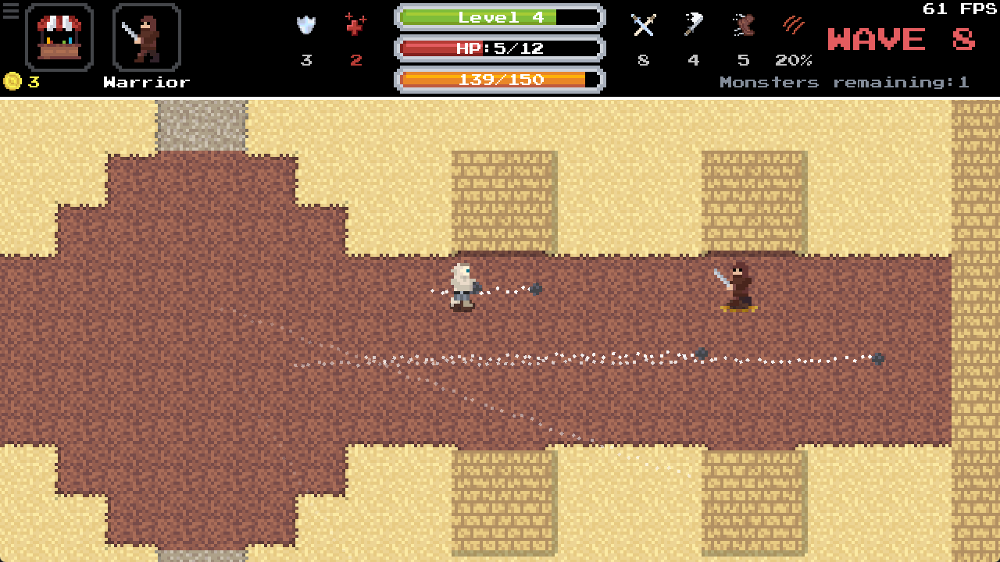
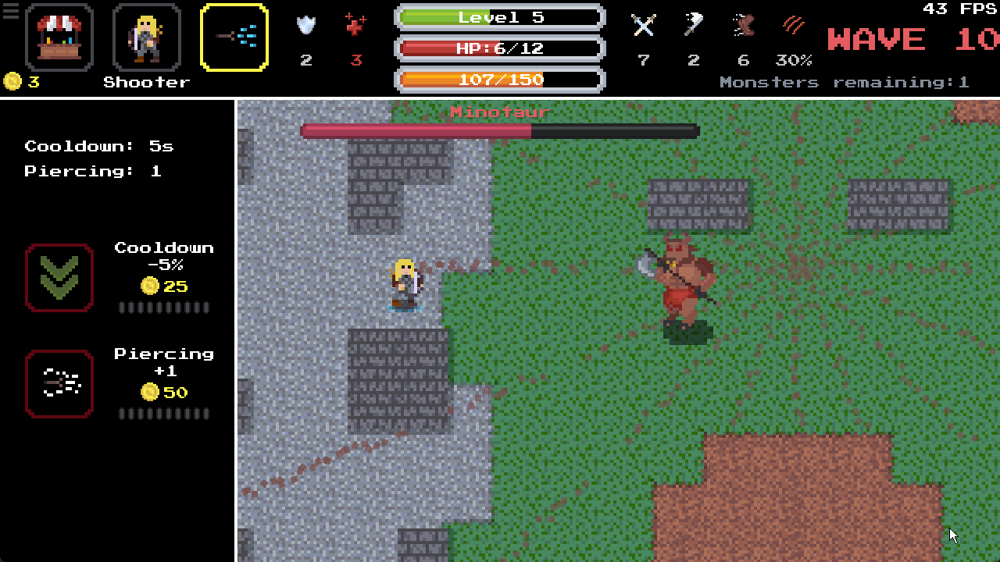
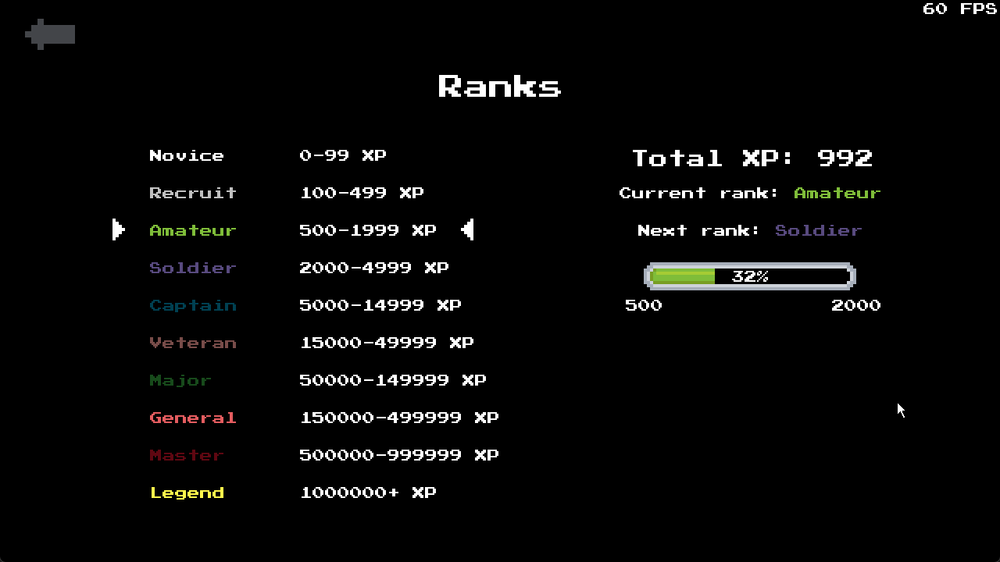

# Defnight

2D RPG PvE game made in C++ and SFML

<p align="center">
    
</p>

Single-player PVE/mob arena game. Your objective is to survive for as long as you can. Before the start of the game, you can choose a map, hero and difficulty (more heroes coming in the future). The game is split into waves of monsters, with different types of monsters and difficulties. Every 10th wave is a boss fight. When you reach a new level, you can choose which attribute to level up. At levels 5 and 10, you can upgrade your current hero, gaining new abilities. Gold you've collected can be spent in the shop, hero screen or upgrading abilities.

Game features several sounds and dynamic music during gameplay. With collecting XP during gameplay, you can gain new ranks to showcase your skills. Ranks page can be visited in left corner of main menu. Your history of waves and monsters killed is collected and stored in encrypted ```.dat``` file and presented in Statistics page. In settings you can change window properties, fps limit, audio volume and language (English/Polish).

The keybinds include:
- Return - **Esc**
- Movement - **WSAD**
- Sprint - **LShift**
- Attack - **Hold Left Mouse Button**
- Ability - **Hold Right Mouse Button**
- Shop - **E**
- Hero - **R**
- Ability Upgrade - **F**

|  |  |
| ---------------------------- | ---------------------------- |
|  |  |

## Getting Started
You can download compiled game straight from [ITCH.IO](https://piterson25.itch.io/defnight) (compiled for win-x64 and Arch Linux).

### Build
To build it make sure you have C++20 compiler and CMake (version 3.28+):
```sh
cmake -S . -B build
```
```sh
cmake --build build --config Release -j
```

## Built With
* [SFML](https://github.com/SFML/SFML) - Graphics Library
* [Tiny AES in C](https://github.com/kokke/tiny-AES-c) - Used in loading and encrypting player stats

## License
Defnight is licensed under the GPL License. See [LICENSE](https://github.com/Piterson25/Defnight/blob/main/LICENSE.md) for more information.
